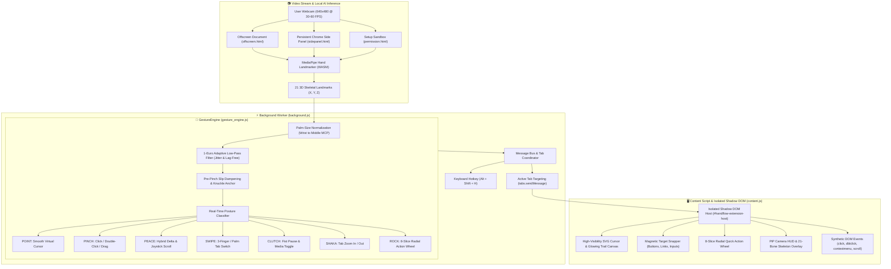

<div align="center">

# 🖐️ Handdy (HandFlow)
### Universal Hand-Tracked Air Mouse & Gesture Controller for Google Chrome

A production-grade **Chrome Extension (Manifest V3)** powered by **MediaPipe Hand Landmarker** (`@mediapipe/tasks-vision` on-device WebAssembly). Replaces physical mice with natural hand gestures—point, click, double-click, drag-and-drop, scroll, swipe between tabs, zoom, clutch, and control media across every Chrome tab with zero cloud latency.

[](https://developer.chrome.com/docs/extensions/mv3/intro/)
[](https://ai.google.dev/edge/mediapipe/solutions/vision/hand_landmarker)
[](https://webassembly.org/)
[](https://developer.mozilla.org/en-US/docs/Web/JavaScript)
[](./LICENSE)
[]()

<br>

<p align="center">
  <a href="#-overview"><b>Overview</b></a> •
  <a href="#-key-features"><b>Key Features</b></a> •
  <a href="#-gesture-cheat-sheet"><b>Gesture Cheat Sheet</b></a> •
  <a href="#-system-architecture"><b>Architecture</b></a> •
  <a href="#-chrome-installation-guide"><b>Installation</b></a> •
  <a href="#-configuration--customization"><b>Configuration</b></a> •
  <a href="#-project-structure"><b>Structure</b></a> •
  <a href="#-connect--author"><b>Connect</b></a>
</p>

</div>

---

## 📖 Overview

Touchscreens are inaccessible from across a desk, physical mice cause repetitive strain during extended reading, and presenting slides or watching cooking videos while your hands are messy requires awkward pauses.

**Handdy (HandFlow)** transforms any standard laptop webcam or USB camera into a high-precision, contactless spatial mouse. Running a custom-quantized **MediaPipe Hand Landmarker** model entirely in local WebAssembly, Handdy extracts **21 3D skeletal hand landmarks** at 30–60 FPS. It applies **1-Euro adaptive low-pass filtering**, **knuckle-anchored position tracking**, and **magnetic target snapping** to deliver fluid, jitter-free cursor control that feels as natural and reliable as a physical mouse—without transmitting a single pixel or video frame over the network.

---

## ✨ Key Features

| Capability | Technical Implementation & User Benefit |
| :--- | :--- |
| **🧠 100% On-Device AI Vision** | Bundled `@mediapipe/tasks-vision` WASM runtime and local `models/hand_landmarker.task`. Zero external API calls, zero cloud dependencies, and zero privacy compromise. |
| **🎯 Knuckle-Anchored Cursor Stabilization** | Tracks a weighted blend of the Index MCP knuckle (`[5]`) and Index Tip (`[8]`) rather than the fingertip alone, eliminating the common "downward cursor dip" that occurs when closing fingers to click. |
| **⚡ 1-Euro Adaptive Low-Pass Filter** | Dynamically adapts cutoff frequencies based on instantaneous hand speed: freezes micro-tremors when hovering, yet delivers immediate zero-lag response during rapid swiping. |
| **🧲 Magnetic Target Snap** | Subtly detects nearby interactive DOM elements (`button`, `a[href]`, `input`, `select`, sliders) and gently pulls the cursor toward them, removing the need for millimeter-level precision. |
| **🔄 Windows Single-Camera Coordinator** | Custom ownership router in `background.js` coordinates stream access between the **Chrome Side Panel**, **Offscreen Document**, and **Permission Sandbox**, preventing Windows webcam device locks (`NotReadableError`). |
| **🎡 8-Slice Radial Quick Action Wheel** | Triggered by a Rock sign (`🤘`) or Thumb+Middle pinch (`👌`), offering instant one-handed access to *Back*, *Forward*, *Reload*, *New Tab*, *Close Tab*, *Scroll to Top*, *Scroll to Bottom*, and *Full Screen*. |
| **🛡️ Isolated Shadow DOM Injection** | Renders the custom SVG pointer, glowing particle trail, and PiP camera HUD inside an isolated Shadow DOM (`#handflow-extension-host`) with `z-index: 2147483647`, preventing CSS style contamination on any website. |
| **⌨️ Global Keyboard Hotkey** | Instantly toggle hand tracking ON or OFF from anywhere in Chrome using the configurable shortcut: `Alt + Shift + H`. |

---

## 🖐️ Gesture Cheat Sheet

Handdy maps natural human hand postures to standard mouse and browser actions:

| Gesture | Hand Posture | Trigger Condition | Browser & Mouse Action |
| :--- | :--- | :--- | :--- |
| **Move Pointer** | `☝️` **Index Extended** | Index finger upright, other fingers curled | Smooth virtual cursor navigation with adaptive 1-Euro smoothing and magnetic snapping. |
| **Left Click** | `🤏` **Quick Pinch** | Thumb tip touches Index tip (`< 420ms`) | Dispatches standard DOM `mousedown`, `mouseup`, and `click` on elements under the cursor. |
| **Double Click** | `🤏x2` **Double Pinch** | Two consecutive pinches within `440ms` | Dispatches `dblclick` (e.g., toggles fullscreen YouTube video or selects word text). |
| **Drag & Drop** | `🤏⏳` **Pinch & Hold** | Pinch held for `> 340ms`, then move hand | Drags draggable elements, selects multi-line text, and scrubs `<input type="range">` sliders. |
| **Right Click** | `👌` **Middle Pinch** | Thumb tip touches Middle tip while Index is up | Dispatches native `contextmenu` event at the current pointer coordinates. |
| **Action Wheel** | `🤘` **Rock Sign** | Index + Pinky extended, Middle + Ring curled | Toggles the 8-slice circular radial shortcut menu around the cursor. |
| **Smooth Scroll** | `✌️` **Peace Sign** | Index + Middle extended together | Hybrid velocity + joystick scroll: move hand up/down/left/right to scroll containers or pages. |
| **Switch Tabs** | `🖐️` **Horizontal Swipe** | 3 fingers extended or open palm swiped sideways | Swipe Left &rarr; **Previous Tab** (`tabs.highlight`), Swipe Right &rarr; **Next Tab**. |
| **Mouse Clutch** | `✊` **Closed Fist** | All fingers curled into a fist | Freezes the virtual cursor in place, allowing you to reposition your hand in physical space. |
| **Media Play / Pause**| `✊⏳` **Fist Hold** | Hold Closed Fist steady for `1.1 seconds` | Automatically finds and toggles play/pause on `<video>` or `<audio>` elements on the active page. |
| **Page Zoom** | `🤙` **Shaka Sign** | Thumb + Pinky extended outward, move hand | Move hand upward &rarr; **Zoom In** (`+10%`), Move hand downward &rarr; **Zoom Out** (`-10%`). |
| **Dwell Auto-Click** | `⏱️` **Hover Steady** | Rest cursor over element for `1.0s` (optional) | Hands-free click for users with motor impairments or fatigue (configurable in popup). |

---

## 🏛️ System Architecture

The following diagram illustrates Handdy's dataflow across the webcam stream, MediaPipe WebAssembly inference, GestureEngine event synthesizer, Background service worker, and Shadow DOM content script:



---

## 🚀 Chrome Installation Guide

### Prerequisites
* **Google Chrome** (version 116+ recommended for Manifest V3 SidePanel and Offscreen APIs).
* Built-in webcam or external USB camera.

### Step-by-Step Setup

1. **Clone or Download the Repository**:
   ```bash
   git clone https://github.com/harinarayana1457-cmyk/Handdy.git
   ```

2. **Open Extensions in Chrome**:
   - Navigate to `chrome://extensions` in your address bar.
   - Toggle **Developer mode** ON (switch in the top-right corner).

3. **Load the Unpacked Extension**:
   - Click the **"Load unpacked"** button in the top-left corner.
   - Select the cloned `Handdy` root folder containing `manifest.json`.

4. **Grant Camera Permission**:
   - The **HandFlow Setup & Gesture Sandbox** page (`permission.html`) will automatically launch on first install.
   - Click **"📷 Grant Camera Access & Start"** and allow camera permissions in Chrome.

5. **Start Browsing Hands-Free**:
   - Navigate to any website (e.g. news sites, YouTube, or documentation).
   - Use the **Persistent Side Panel** (click extension icon &rarr; *"Open Side Panel"*) for continuous hand tracking across all tabs.
   - Press `Alt + Shift + H` anytime to toggle hand tracking ON or OFF.

---

## ⚙️ Configuration & Customization

Click the **Handdy toolbar icon** or open the side panel to fine-tune your tracking parameters:

```
+-------------------------------------------------------------------+
|                        Handdy Settings Panel                      |
+-------------------------------------------------------------------+
|  [x] Enable Hand Tracking (Alt + Shift + H)                       |
|                                                                   |
|  Sensitivity Multiplier       [====|======]  1.35x                |
|  1-Euro Smoothing Filter      [======|====]  0.65                 |
|  Pinch Trigger Threshold      [===|=======]  0.28                 |
|  Scroll Speed Multiplier      [=====|=====]  1.25x                |
|                                                                   |
|  [x] Magnetic Target Snapping (Snap to buttons & links)           |
|  [ ] Invert Natural Scrolling                                     |
|  [x] Mirror Camera Preview                                        |
|  [ ] Dwell Auto-Click (Hover 1.0s to click)                       |
|                                                                   |
|  Camera HUD Position:         (o) Bottom-Right  ( ) Top-Right     |
|                               ( ) Bottom-Left   ( ) Top-Left      |
|                                                                   |
|  [ Open Setup Sandbox ]       [ Open Side Panel (Recommended) ]   |
+-------------------------------------------------------------------+
```

| Setting Key | Default | Recommended Range | Description |
| :--- | :--- | :--- | :--- |
| `sensitivity` | `1.35` | `0.8 – 2.0` | Active bounding box scaling. Higher values mean less physical hand movement covers the entire screen. |
| `smoothing` | `0.65` | `0.3 – 0.9` | 1-Euro filter strength. Higher values reduce jitter; lower values maximize raw response speed. |
| `pinchThreshold` | `0.28` | `0.20 – 0.38` | Normalized distance between thumb and index tip required to trigger click/drag actions. |
| `scrollSpeed` | `1.25` | `0.5 – 2.5` | Multiplier applied to vertical and horizontal Peace Sign (`✌️`) scrolling motions. |
| `magneticSnap` | `true` | `boolean` | Gently guides the cursor toward nearby clickable buttons, links, and input elements. |
| `dwellClick` | `false` | `boolean` | When enabled, holding the cursor steady over an element for `dwellTimeMs` automatically clicks it. |
| `dwellTimeMs` | `1000` | `600 – 2000` | Dwell duration in milliseconds before an auto-click is dispatched. |
| `mirrorCamera` | `true` | `boolean` | Mirrors the camera feed horizontally so moving your hand right moves the cursor right. |
| `showCameraHud` | `true` | `boolean` | Displays a lightweight Picture-in-Picture camera preview in the corner of web pages. |
| `showSkeleton` | `true` | `boolean` | Overlays the 21-point MediaPipe hand skeleton landmarks on the camera preview. |

---

## 📁 Project Structure

```
Handdy/
├── manifest.json              # Chrome Extension Manifest V3 configuration & permissions
├── background.js              # Background service worker, tab messaging & camera ownership
├── gesture_engine.js          # Core AI gesture engine, 1-Euro filter & posture classifier
├── content.js                 # Shadow DOM cursor renderer, magnetic snap & event dispatcher
├── offscreen.html             # Offscreen audio/video processing document
├── offscreen.js               # Offscreen WebAssembly MediaPipe tracker worker
├── sidepanel.html             # Persistent side panel interface with live tracking HUD
├── sidepanel.js               # Side panel controller & live landmark rendering
├── popup.html                 # Extension toolbar popup for quick toggle & settings
├── popup.js                   # Popup settings persistence & messaging controller
├── permission.html            # First-run onboarding wizard & interactive gesture sandbox
├── permission.js              # Permission granting script & live testing canvas
├── camera_frame.html          # Web-accessible iframe container for secure camera capture
├── camera_frame.js            # Video capture stream handler
├── models/
│   └── hand_landmarker.task   # Pre-trained on-device MediaPipe 21-point hand landmark model
├── lib/
│   └── mediapipe/             # Local MediaPipe Tasks Vision bundle & WASM binaries
│       ├── vision_bundle.js   # Compiled MediaPipe vision runtime
│       ├── vision_bundle.mjs  # ES Module version of MediaPipe runtime
│       └── wasm/              # WebAssembly binaries for high-performance SIMD inference
├── icons/                     # Extension branding icons (16px, 48px, 128px)
├── LICENSE                    # MIT open-source license
└── README.md                  # Comprehensive documentation
```

---

## 🔒 Privacy & Permissions

Handdy strictly adheres to Chrome's principle of least privilege:

* **Camera (`navigator.mediaDevices.getUserMedia`)**: Used exclusively for local frame processing by the bundled MediaPipe WebAssembly model. Video frames are processed in-memory frame-by-frame and immediately discarded. No video, images, or telemetry are ever uploaded or transmitted.
* **Storage (`storage`)**: Saves your personal preferences (sensitivity, smoothing, gestures) locally in `chrome.storage.local`.
* **Side Panel (`sidePanel`) & Offscreen (`offscreen`)**: Keeps the MediaPipe tracking loop alive across tab transitions without duplicating webcam streams.
* **Scripting & Active Tab (`scripting`, `activeTab`, `<all_urls>`)**: Injects the isolated virtual pointer and dispatches synthetic click and scroll events into active web pages.

---

## 📄 License

Distributed under the **[MIT License](./LICENSE)**. Free for personal, educational, and commercial use.

---

## 🔗 Connect & Author

**Harinarayana Avvari**

[](https://www.linkedin.com/in/hari-narayana-035ba1389/)
[](https://github.com/harinarayana1457-cmyk)

<div align="center">
  <sub>Engineered with precision for hands-free web accessibility, interactive kiosks, and camera-based spatial human-computer interaction.</sub>
</div>
